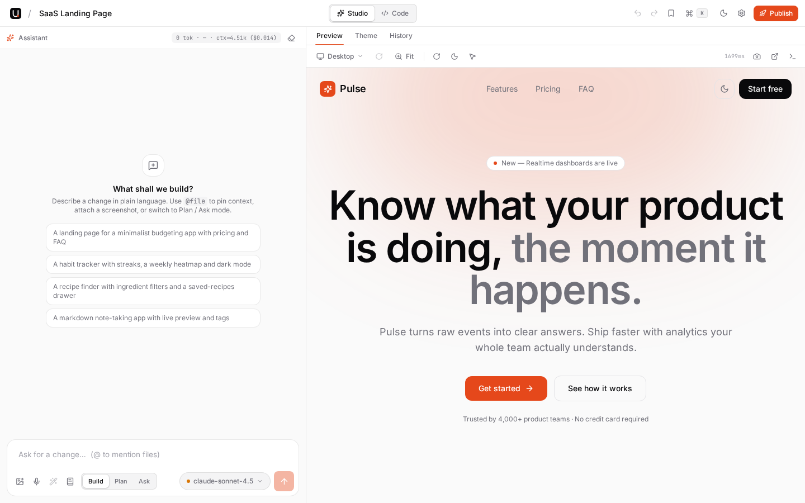
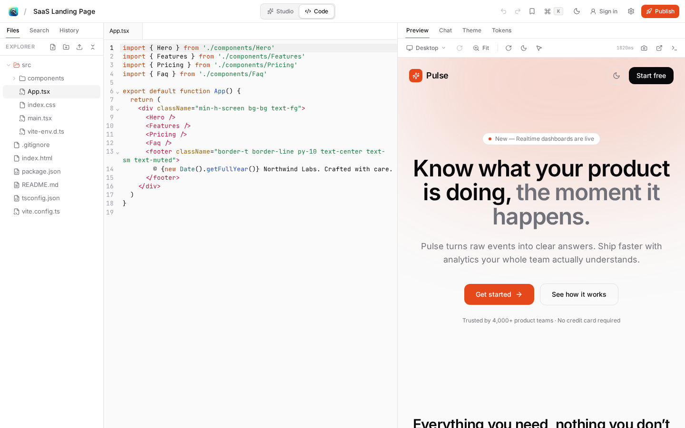

<p align="center"></p>

# UnQStudio · v2.0

**A 100 % static, client-side AI software-engineering studio.** Describe an app, bring your own LLM key, and watch it
compile with `esbuild-wasm` into a sandboxed live preview — no backend, no WebContainers, nothing leaves your device.
Deploys as a plain `dist/` folder on Cloudflare Pages.



| Studio Mode (default) | Code Mode (`⌘E`) |
|---|---|
| Chat-first: conversational AI, step cards, 1-click undo, Prompt Enhancer, live preview, click-to-edit inspector, Theme Studio, Publish | Full IDE on the same live state: explorer with file locks, CodeMirror 6, global search/replace, diff viewer, console, `@file` context, token inspector |



## Features

| Area | What you get |
|------|--------------|
| **Workspace** | Adaptive Studio ↔ Code shell, `⌘K` palette (files, actions, AI modes, models, templates, themes), inline project rename, undo/redo/checkpoints, light/dark (Obsidian / Paper) |
| **VFS** | IndexedDB multi-project file system, rename/move/duplicate/search, **file & folder locking** that blocks the AI, gzip **checkpoints** (restore, fork, diff), ZIP import/export, File System Access folder sync |
| **Runtime** | `esbuild-wasm` (bundled `.wasm` + CDN fallback), VFS resolver (`./`, `../`, `@/`, index/ext probing), CSS + Tailwind v4 browser runtime, npm via `esm.sh` with memory + IndexedDB cache, hot rebuild < 300 ms |
| **Preview** | Sandboxed iframe + `postMessage` bridge: console, errors, unhandled rejections, **Fix with AI**, responsive viewports, rotate, zoom, pop-out, screenshot, element inspector |
| **AI** | 20 direct-browser BYOK providers, Build / Plan / Ask modes, streaming artifact parser, `<think>` UI, **search/replace patches**, approval tray, Prompt Enhancer, vision, voice, `@file` pinning, rules library, chat fork, token & cost meter, encrypted key vault (PBKDF2 + AES-GCM) |
| **Templates** | 8 curated static templates (SaaS, dashboard, portfolio, storefront, AI chat, kanban, blog+docs, blank) — each compiled **and `tsc --strict`-checked** in CI |
| **Settings hub** | Providers, Connections, Prompts, Data (backup/restore, storage meter), Debug (event log, diagnostics), Features & plugin registry (themes, templates, providers, remote MCP connectors) |
| **Publish** | ZIP, GitHub (import / push / Pages workflow), GitLab, Netlify, Vercel, Cloudflare Pages (+ Git-connect fallback), Supabase explorer + typed client |

## Quickstart

```bash
npm install
npm run dev          # http://localhost:5173
npm run test         # 100+ unit tests (vitest)
npm run lint && npm run typecheck
npm run build        # static bundle in dist/
npm run preview      # serve dist/
npm run e2e          # headless Chromium end-to-end check (needs `npx playwright install chromium`)
```

On first use press the model pill → **Quick setup**, pick a provider (OpenRouter, Gemini, Groq, Cerebras and GitHub Models have free tiers) and paste a key.

## Architecture

```
┌──────────────────────────── src/ui  (React 19 + Tailwind v4 + Zustand) ───────────────────────────┐
│  Home · Studio · Code Mode · Settings · Publish hub · Command palette · primitives                  │
└───────┬───────────────────┬────────────────────┬─────────────────────┬────────────────────────────┘
        │                   │                    │                     │
  core/vfs/            core/runtime/        core/ai/              core/deploy/
  IStorageAdapter      IRuntimeEngine       IAIProvider registry  GitHub · GitLab · Netlify
  IndexedDB · locks    EsbuildWasmEngine    stream · parser ·     Vercel · Cloudflare ·
  checkpoints · zip    plugins · preview    patch · vault ·       Supabase (all REST,
                       bridge               orchestrator          browser → API)
```

Details: [ARCHITECTURE.md](./ARCHITECTURE.md) · [DESIGN_SYSTEM.md](./DESIGN_SYSTEM.md) · [DOCS/FEATURES.md](./DOCS/FEATURES.md) · [DOCS/DEPLOYMENT.md](./DOCS/DEPLOYMENT.md)

## Deploy to Cloudflare Pages (static)

1. Push this repo to GitHub. 2. Cloudflare → Workers & Pages → Create → Connect to Git. 3. Build command `npm run build`, output `dist`. 4. Deploy.
`public/_redirects` and `public/_headers` are already configured. Full guide: [DOCS/DEPLOYMENT.md](./DOCS/DEPLOYMENT.md).

## Security & privacy

API keys and tokens live in IndexedDB on your device (optionally AES-GCM encrypted with a passphrase). They are sent only to the provider/service you configure.
No telemetry, no server. The preview runs in an opaque-origin sandbox, so generated code can never read your keys.
